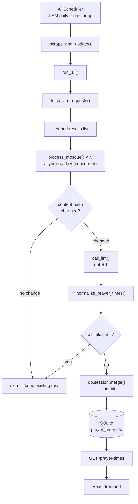

# Jamaat Backend — End-to-End Explainer

## TL;DR

Once a day at 3 AM (Toronto time), a scheduler fires a scrape job. The job visits every mosque website using httpx + BeautifulSoup, extracts the page text, sends it to GPT with a carefully written prompt, and asks GPT to return the prayer times as JSON. The times are cleaned up, validated, and saved to a SQLite database (one row per mosque). The Flask API then serves those rows at `GET /prayer-times` so the React frontend can display them.

---

## Big-Picture Flow




---


## File Map


| File                          | What it does                                                                       |
| ----------------------------- | ---------------------------------------------------------------------------------- |
| `app.py`                      | Flask app factory — CORS, DB init, register routes, start scheduler                |
| `scheduler.py`                | APScheduler setup, cron job registration, WERKZEUG guard, atexit shutdown          |
| `config.py`                   | SQLAlchemy URI from `DATABASE_PATH` env var; `EASTERN` timezone constant           |
| `mosques.py`                  | Static list of mosques with metadata and per-mosque scraping config                |
| `models/prayerTimes.py`       | SQLAlchemy model for the `prayer_times` table + `to_dict()` serializer             |
| `routes/health.py`            | `GET /health`                                                                      |
| `routes/prayer_times.py`      | `GET /prayer-times`                                                                |
| `routes/mosque_requests.py`   | `POST /mosque-request` — validation and Google Sheets webhook forwarding           |
| `scraping/fetch.py`           | `fetch_via_requests`, `scrape_all_mosques` — httpx scraping with retry             |
| `scraping/text.py`            | `clean_text`, `TIME_PATTERN` — normalise raw scraped text before hashing/prompting |
| `scraping/prompt.py`          | `PROMPT_TEMPLATE`, `build_prompt` — assemble the LLM prompt with today's date      |
| `scraping/llm.py`             | OpenAI client, `call_llm` — call GPT and parse JSON response                      |
| `scraping/parsing.py`         | `format_time`, `normalize_prayer_times`, prayer name constants                     |
| `scraping/pipeline.py`        | `process_mosque`, `run_all`, `scrape_and_update` — orchestrates the full pipeline  |
| `Dockerfile`                  | Container image (python:3.12-slim), gunicorn entry point                           |
| `fly.toml`                    | Fly.io deployment: region, volume mount, machine settings                          |
| `requirements.txt`            | Python dependencies                                                                |


---


## Startup (`create_app`)

`create_app()` is the Flask application factory — everything is wired together here before the app is returned to gunicorn (or to `python app.py`).

**Order of operations:**

1. `load_dotenv()` reads `.env` as the very first statement in `app.py`, before any local imports. This is required because `scraping/llm.py` creates the OpenAI client at import time from `os.environ["OPENAI_API_KEY"]` — if the key is missing, the process crashes immediately.
2. CORS origins are read from `ALLOWED_ORIGINS`. It accepts a comma-separated list so you can allow multiple frontends. Default: `http://localhost:5173`.
3. `Config` resolves the database path: it reads `DATABASE_PATH` from the environment and falls back to `prayer_times.db` in the same directory as `config.py`. SQLAlchemy is initialized with that URI.
4. `register_routes(app)` registers the three blueprints from `routes/`.
5. `db.create_all()` runs inside an app context, creating the `prayer_times` table if it doesn't exist yet.
6. `start_scheduler(app)` (in `scheduler.py`) creates the APScheduler `BackgroundScheduler` and registers the cron job with `next_run_time=now`, causing an immediate first run.
7. `atexit.register(scheduler.shutdown)` ensures the scheduler stops cleanly when the process exits.

---


## Mosque Registry (`mosques.py`)

`MOSQUES` is a plain Python list of dicts. Each entry has:


| Field        | Required | Description                                         |
| ------------ | -------- | --------------------------------------------------- |
| `name`       | Yes      | Unique identifier; used as the database primary key |
| `address`    | Yes      | Human-readable street address                       |
| `website`    | Yes      | The mosque's public URL (shown to users)            |
| `scrape_url` | No       | If set, this URL is scraped instead of `website`    |
| `latitude`   | Yes      | Used by the frontend for map display                |
| `longitude`  | Yes      | Used by the frontend for map display                |


**Scrape targets:**


| Mosque             | Scrape target                |
| ------------------ | ---------------------------- |
| Baitul Aman        | AthanPlus widget (embed URL) |
| Baitul Mukarram    | AthanPlus widget (embed URL) |
| Masjid Al-Abedeen  | irccan.com (main site)       |
| The Sunatul Jamaat | sunatuljamaat.com (main site)|


All four mosque pages are server-rendered and return complete HTML without requiring JavaScript execution.

---


## Scraping (`fetch_via_requests`)

### Why no fake browser headers?

Some firewalls (for example, irccan.com's WAF) detect bots by looking at the TLS fingerprint. If you send a `User-Agent` string that says "Chrome" but your TLS handshake looks nothing like Chrome's, you get blocked. A plain `httpx` client makes no such claim and is typically served normally. That's why this function intentionally **does not** set `User-Agent` or other browser headers.

### What happens

1. Opens an `httpx.Client` with a 20s timeout and redirect-following enabled.
2. `GET`s the URL. Raises on non-2xx.
3. BeautifulSoup parses the HTML and removes every `<script>`, `<style>`, and `<noscript>` tag.
4. `.get_text(separator="\n")` extracts the visible text.
5. Returns `{**mosque, "raw_text": text}`.


### Retries

```
Attempt 1 → fail → wait 3s  (backoff × 1)
Attempt 2 → fail → wait 6s  (backoff × 2)
Attempt 3 → fail → return None
```

`backoff` defaults to `3.0`. The wait formula is `backoff * attempt`, so the gap grows with each retry. If all three attempts fail, `None` is returned — the caller treats `None` as "keep yesterday's data".

### Concurrency note

Mosques are scraped **one at a time** (sequential loop inside `scrape_all_mosques`), not in parallel. The httpx calls run inside `asyncio.to_thread` so they don't block the event loop.

---


## Text Cleaning (`clean_text`)

Before the text is sent to GPT or hashed, it's normalized. Here's what each regex does:


| Regex                                     | Problem it fixes                       | Example: before → after        |
| ----------------------------------------- | -------------------------------------- | ------------------------------ |
| `[\n\t]+ → space`                         | Line breaks / tabs inside scraped text | `"Fajr\n6:00"` → `"Fajr 6:00"` |
| `\s{2,} → single space`                   | Runs of whitespace                     | `"Fajr 6:00"` → `"Fajr 6:00"`  |
| `([,.:])([^\s]) → \1 \2`                  | Missing space after punctuation        | `"Fajr:6:00"` → `"Fajr: 6:00"` |
| `(\d)\s*:\s*(\d) → \1:\2`                 | Spaces inside a time                   | `"6 : 30"` → `"6:30"`          |
| `(\d:\d\d)([apAP][mM]) → \1 \2`           | No space before AM/PM                  | `"6:30pm"` → `"6:30 pm"`       |
| `(\d:\d\d)\s+([apAP])\s+([mM]) → \1 \2\3` | Broken AM/PM like "p m"                | `"6:30 p m"` → `"6:30 pm"`     |


---


## Change Detection

After cleaning, `process_mosque` computes a SHA-256 hash of the cleaned text and looks up the existing database row. If the hash matches `raw_text_hash` stored in the row, the content hasn't changed since the last run — the LLM call is skipped entirely.

> **Note:** When a mosque is skipped this way, its `date` and `updated_at` columns are **not updated**. The row keeps its values from the last time the content actually changed.

---


## LLM Extraction (`scraping/llm.py` + `scraping/prompt.py`)


### API call settings


| Setting                 | Value                                                               |
| ----------------------- | ------------------------------------------------------------------- |
| Model                   | `gpt-5.1`                                                           |
| `max_completion_tokens` | 500                                                                 |
| `top_p`                 | 1                                                                   |
| Timeout                 | 30s                                                                 |
| System message          | "You are a helpful assistant that only outputs valid JSON objects." |


The response is parsed immediately with `json.loads`. There is **no retry** — any error (timeout, bad JSON, API failure) returns `None`, which causes `process_mosque` to skip that mosque and keep its existing row.

### The date label

The prompt includes today's date formatted as, for example: `Saturday, October 17, 2026`. This matters because some mosque sites display a weekly or monthly calendar. The model uses the date to find and extract only today's row, ignoring all the others.

### Prompt rules (plain English summary)

The `PROMPT_TEMPLATE` is long and detailed. Here's what it tells the model:

**General time rules:**

- Copy times **exactly** as written — no rounding or guessing.
- If two times are listed for one prayer, the **earliest** is the start (adhan/begins/khutbah), the **latest** is the iqamah (congregational time).
- If **only one** time is listed, it is the **iqamah**; set `_start` to `null`.
- Handle times that are glued to words without spaces (e.g. `"Iqamah2:00pm"` → extract `"2:00pm"`).
- Handle times split across lines (e.g. `"6\n:30\npm"` → `"6:30 pm"`).
- If no valid time can be found for a prayer, set the value to `null`.

**Multi-day pages:**

- If the page shows times for several days, extract only the block matching today's date.
- If no block has a recognizable date, use the first block.

**Jummah (Friday prayer) rules:**

- Any time between 12:00 PM and 5:00 PM that appears near other Jummah times counts as a Jummah time, even if not labeled.
- Up to 3 slots: `jummah1`, `jummah2`, `jummah3`.
- **Numbered slot labels take priority:** if labels like "1st Jamat", "Jumuah 2" etc. are present, map them directly (slot 1 → `jummah1_iqamah`, etc.).
- **Count-based pairing** (when no numbered labels): 1 time → `jummah1_iqamah` only; 2–5 times → pair left-to-right as start/iqamah; 6 times → 3 full pairs.
- Khutbah time always maps to `_start`; Iqamah time always maps to `_iqamah`.


### Output schema

The model must return exactly this JSON shape (16 fields):

```json
{
  "fajr_start":     "HH:MM AM/PM or null",
  "fajr_iqamah":    "...",
  "zuhr_start":     "...",
  "zuhr_iqamah":    "...",
  "asr_start":      "...",
  "asr_iqamah":     "...",
  "maghrib_start":  "...",
  "maghrib_iqamah": "...",
  "isha_start":     "...",
  "isha_iqamah":    "...",
  "jummah1_start":  "...",
  "jummah1_iqamah": "...",
  "jummah2_start":  "...",
  "jummah2_iqamah": "...",
  "jummah3_start":  "...",
  "jummah3_iqamah": "..."
}
```


### Concurrency

Even though scraping is sequential, the LLM calls for all mosques are launched **concurrently** using `asyncio.gather`. Each `process_mosque` coroutine runs `call_llm` in a thread via `asyncio.to_thread`, so all pending LLM requests are in-flight at the same time.

---


## Normalization and Validation


### `normalize_prayer_times`

After the LLM returns its JSON, each prayer's pair of times is checked with `normalize_pair`:


| Situation                                           | Action                                       |
| --------------------------------------------------- | -------------------------------------------- |
| Both times present, start ≥ iqamah (reversed order) | Swap them                                    |
| Only `_start` is non-null                           | Move value to `_iqamah`, set `_start = null` |
| Only `_iqamah` is non-null                          | Leave as-is                                  |
| Both null                                           | Leave as-is                                  |


### `format_time`

Converts a string like `"6:30 PM"` to a Python `time` object using `strptime("%I:%M %p")`. This is strict — it requires a space before AM/PM and no periods. That's exactly why `clean_text` normalizes `"6:30pm"` → `"6:30 pm"` and `"p m"` → `"pm"` before anything else.

Returns `None` for any value that can't be parsed (including the strings `"null"` and `"none"`).

### All-null rejection

After formatting, if every one of the ten daily prayer fields (`fajr_start` through `isha_iqamah`) is `None`, the result is rejected and the existing database row is kept. Jummah fields are excluded from this check — a Jummah-only response would still be rejected if the five daily prayers are all null.

### Debug side effect

If the mosque being processed is "Masjid Al-Abedeen", the full prompt string is written to `prompt_abedeen.txt` in the working directory. This is a debugging aid left in from development.

---


## Database


### Table: `prayer_times`


| Column           | Type       | Notes                                              |
| ---------------- | ---------- | -------------------------------------------------- |
| `mosque_name`    | `String`   | **Primary key** — one row per mosque, no history   |
| `date`           | `Date`     | The date of the last successful scrape             |
| `fajr_start`     | `Time`     | nullable                                           |
| `fajr_iqamah`    | `Time`     | nullable                                           |
| `zuhr_start`     | `Time`     | nullable                                           |
| `zuhr_iqamah`    | `Time`     | nullable                                           |
| `asr_start`      | `Time`     | nullable                                           |
| `asr_iqamah`     | `Time`     | nullable                                           |
| `maghrib_start`  | `Time`     | nullable                                           |
| `maghrib_iqamah` | `Time`     | nullable                                           |
| `isha_start`     | `Time`     | nullable                                           |
| `isha_iqamah`    | `Time`     | nullable                                           |
| `jummah1_start`  | `Time`     | nullable                                           |
| `jummah1_iqamah` | `Time`     | nullable                                           |
| `jummah2_start`  | `Time`     | nullable                                           |
| `jummah2_iqamah` | `Time`     | nullable                                           |
| `jummah3_start`  | `Time`     | nullable                                           |
| `jummah3_iqamah` | `Time`     | nullable                                           |
| `raw_text_hash`  | `String`   | SHA-256 of cleaned text; used for change detection |
| `updated_at`     | `DateTime` | Set to UTC now on every write                      |


SQLite stores `Time` columns as strings (`"HH:MM:SS"`). `to_dict()` keeps them in that format and ensures `updated_at` is marked with UTC timezone info before serializing to ISO 8601.

### Writes

`db.session.merge(record)` is used instead of `add`. This means:

- If no row exists for the mosque → **INSERT**.
- If a row already exists → **UPDATE** in place.

A single `db.session.commit()` is called after all records are merged.

---


## API Routes


### `GET /prayer-times`

Returns the prayer times for all mosques, merged with their metadata from `MOSQUES`.

**How the merge works:** For every database row, the code looks up the matching entry in `MOSQUES` by `name`. The mosque's address, website, and coordinates are combined with the prayer times dict. If a mosque exists in `MOSQUES` but has no database row yet (e.g. first run hasn't completed), it is **omitted** from the response.

**Example response (one mosque):**

```json
[
  {
    "name": "Baitul Aman",
    "address": "3114 Danforth Ave, Scarborough, ON M1L 1B1",
    "website": "https://timing.athanplus.com/...",
    "latitude": 43.691767,
    "longitude": -79.287482,
    "prayer_times": {
      "mosque_name": "Baitul Aman",
      "date": "2026-10-17",
      "fajr_start": "05:30:00",
      "fajr_iqamah": "06:00:00",
      "zuhr_start": null,
      "zuhr_iqamah": "13:30:00",
      ...
      "updated_at": "2026-10-17T07:05:12+00:00"
    }
  }
]
```

---


### `GET /health`

Returns `{"status": "ok"}` with HTTP 200. Used by Fly.io and load balancers to check the process is alive.

---


### `POST /mosque-request`

Lets users submit a request to add a new mosque. The request body is forwarded to a Google Sheets webhook.

**Request body (JSON):**

```json
{
  "mosque_name": "Some Mosque",
  "additional_info": "Optional details"
}
```

**Validation:**

- `mosque_name` is required.
- `mosque_name` max length: 200 characters.
- `additional_info` max length: 2000 characters.

**What's forwarded to the webhook:**

```json
{
  "mosque_name": "Some Mosque",
  "additional_info": "Optional details",
  "submitter_ip": "1.2.3.4"
}
```

The submitter's IP is read from `X-Forwarded-For` (set by Fly.io's proxy) and included for spam control. The webhook call has an 8s timeout.

**Status codes:**


| Code | Situation                                          |
| ---- | -------------------------------------------------- |
| 201  | Success                                            |
| 400  | `mosque_name` missing or a field is too long       |
| 502  | Webhook call failed or returned a non-2xx status   |
| 503  | `GSHEET_WEBHOOK_URL` is not set in the environment |


---


## Scheduler (The Cron Job)

The scrape job is managed by APScheduler's `BackgroundScheduler`, which runs in a daemon thread inside the same process as Flask.


| Setting                   | Value                           | Why                                                                                 |
| ------------------------- | ------------------------------- | ----------------------------------------------------------------------------------- |
| Timezone                  | `America/Toronto`               | Mosque websites are local; 3 AM local is safely after midnight for daily updates    |
| Schedule                  | `cron, hour=3, minute=0`        | Fires once per day at 3:00 AM                                                       |
| `next_run_time=now`       | Immediate run on startup        | Ensures data is fresh right after a deploy or restart                               |
| `max_instances=1`         | Only one run at a time          | Prevents a second run from starting if the previous one is still going              |
| `coalesce=True`           | Missed runs are merged into one | If the machine was down at 3 AM and comes back at 3:30, only one catch-up run fires |
| `misfire_grace_time=3600` | Allow up to 1 hour late         | A job missed by more than 1 hour is dropped rather than run unexpectedly            |


### Double-scheduler guard

```python
if not app.debug or os.environ.get("WERKZEUG_RUN_MAIN") == "true":
    scheduler.start()
```

Flask's debug reloader forks the process twice. Without this guard, two schedulers would start. The check ensures only the child process (the one that actually handles requests) starts the scheduler.

### Inside `scrape_and_update`

The scheduler calls this synchronous function in its own thread. It creates a Flask app context (required for `db.session` to work), then calls `asyncio.run(run_all())` to run the entire async scrape+process pipeline synchronously from that thread.

---


## Retries and Fallbacks Cheat Sheet


| What fails                         | What happens               | End result           |
| ---------------------------------- | -------------------------- | -------------------- |
| httpx attempt 1 or 2               | Wait and retry (3s, then 6s) | May eventually succeed |
| All 3 httpx attempts               | Return `None`              | Keep existing DB row |
| LLM timeout / bad JSON / API error | Return `None`              | Keep existing DB row |
| LLM returns all-null daily times   | Reject result              | Keep existing DB row |
| Content hash unchanged             | Skip LLM entirely          | Row unchanged (date stays stale) |


In almost every failure scenario the outcome is the same: **the existing database row is kept** and the frontend continues to show yesterday's data.

---


## Deployment


### Dockerfile

```
Base image:  python:3.12-slim

Entry point: gunicorn
             --workers 1        (one process → one APScheduler instance)
             --threads 4        (handles concurrent API reads)
             --timeout 300      (per-request worker timeout; does not apply to the
                                 scheduler thread, so it doesn't limit scrape jobs)
             app:create_app()
```

One worker is deliberate. Multiple workers would each start their own scheduler, causing duplicate scrape runs and potential DB conflicts.

### Fly.io (`fly.toml`)


| Setting                | Value                  | Why                                                  |
| ---------------------- | ---------------------- | ---------------------------------------------------- |
| `primary_region`       | `yyz`                  | Toronto — close to mosque websites and users         |
| Volume mount           | `/data` (persistent)   | SQLite database survives deploys and restarts        |
| `auto_stop_machines`   | `false`                | Machine must stay running to fire the 3 AM cron      |
| `min_machines_running` | `1`                    | Always at least one instance alive                   |
| VM                     | 1 shared CPU, 1 GB RAM | Sufficient for one scrape run at a time              |


### Environment Variables


| Variable             | Required | Description                                                                         |
| -------------------- | -------- | ----------------------------------------------------------------------------------- |
| `OPENAI_API_KEY`     | **Yes**  | OpenAI API key; app crashes on startup if missing                                   |
| `DATABASE_PATH`      | No       | Path to SQLite file (default: `prayer_times.db` in project root)                    |
| `ALLOWED_ORIGINS`    | No       | Comma-separated CORS origins (default: `http://localhost:5173`)                     |
| `GSHEET_WEBHOOK_URL` | No       | Google Sheets webhook for mosque requests; `/mosque-request` returns 503 without it |
| `PORT`               | No       | Port gunicorn binds to (default: `8080` via fly.toml)                               |


---


## Running Locally

```bash
cd backend
pip install -r requirements.txt

# Create .env
echo "OPENAI_API_KEY=your_key_here" > .env

# Start the server
python app.py
```

The server starts on `http://localhost:5000`. Because `next_run_time=datetime.now(EASTERN)` is set, the scrape job fires **immediately** on startup — expect LLM API calls within seconds.

To hit the API:

```bash
curl http://localhost:5000/prayer-times
curl http://localhost:5000/health
```

---


## Known Quirks and Gotchas

These are factual observations about the current code, not bugs to fix immediately.

1. **Missing Jummah key causes a** `KeyError` — In `process_mosque` (`scraping/pipeline.py`), Jummah fields are accessed with direct dict keys (no `.get()`). If the LLM omits any `jummah*` key from its JSON, a `KeyError` is raised. Because `asyncio.gather` is called without `return_exceptions=True`, a single mosque's error will bubble up and **prevent all mosques from being saved** in that run.
2. **Debug file left in production** — For "Masjid Al-Abedeen", the full prompt is written to `prompt_abedeen.txt` on every run where the content has changed. This file is excluded by `.dockerignore` but still gets written inside the running container.
3. **Stale** `date` **on hash-skip** — When a mosque's content hash is unchanged, its row is not written. The `date` column stays set to whenever the content last changed, not today's date. The frontend receives an older `date` value even if the times are still accurate.

